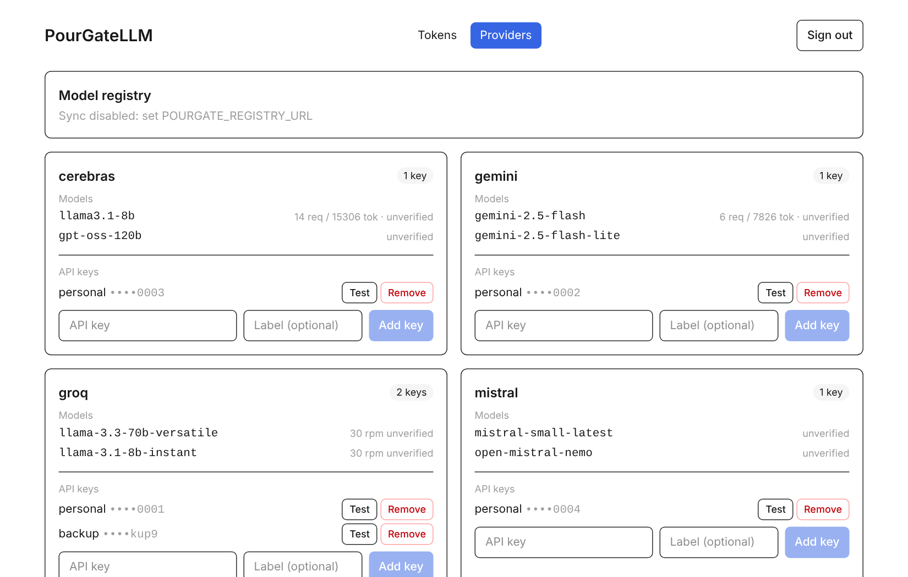
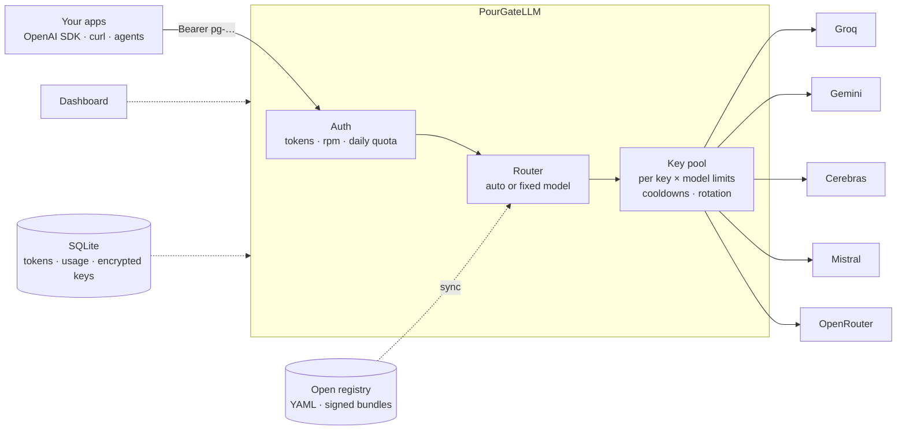
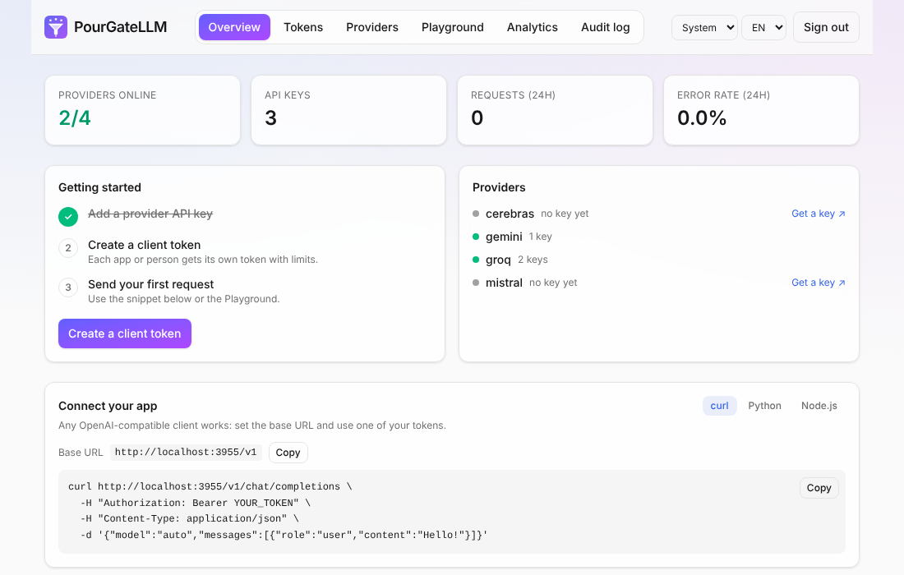
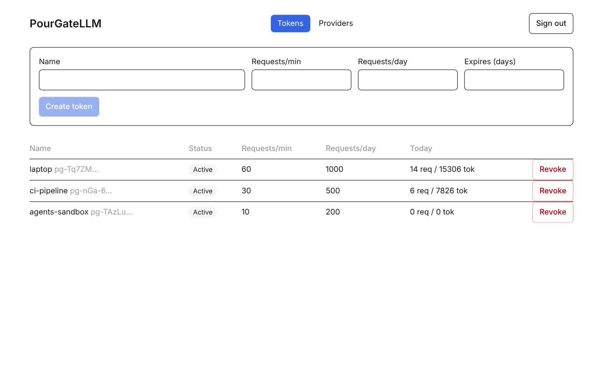
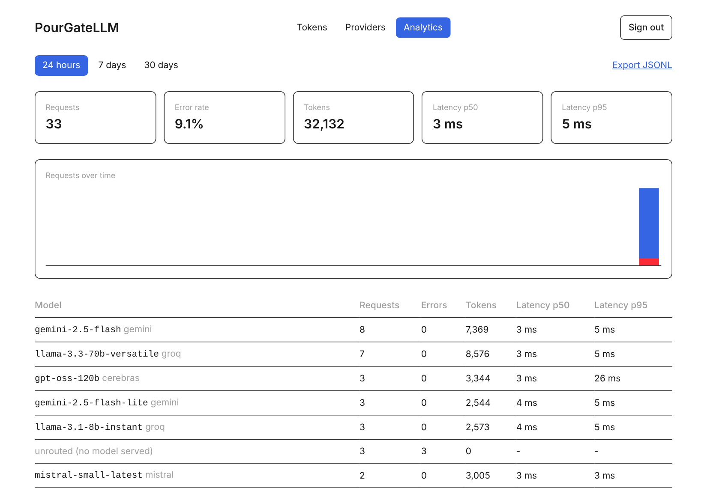

<div align="center">


# PourGateLLM

**One OpenAI-compatible endpoint for every free LLM tier.**
Pour all your providers' free quotas through a single, self-hosted gate: with failover, per-client tokens, an open model registry and a dashboard.

[](https://github.com/xX-VyrnCore-Xx/PourGateLLM/actions/workflows/ci.yml)


[Quick start](#-quick-start) ·
[Features](#-features) ·
[How it works](#-how-it-works) ·
[Configuration](#-configuration) ·
[Roadmap](#-roadmap) ·
[Design doc](DESIGN.md)

<br />

<picture>
  <source media="(prefers-color-scheme: dark)" srcset="docs/screenshots/providers-dark.png">
  
</picture>

</div>

<br />

## Why PourGateLLM?

Free LLM tiers are generous but scattered: different keys, different limits, different failure modes.
PourGateLLM sits in front of them and gives your apps **one stable `/v1` endpoint** that keeps working when a single key or provider runs dry.

- **Drop-in.** Any OpenAI SDK or tool works by changing the base URL and key.
- **Respects limits.** Per-key, per-model `rpm`/`rpd`/`tpm`/`tpd` accounting and cooldowns, kept across restarts.
- **Open catalog.** Providers and models live in a plain-YAML [registry](registry) anyone can improve with a PR. No paywalled feed.
- **Safe by default.** Keys encrypted at rest, hashed client tokens, a registry that can never redirect your keys to unknown hosts.

> [!NOTE]
> PourGateLLM is for **personal and small-team use** of free tiers, within each provider's terms. Rotating many accounts to dodge limits can violate those terms, so don't.

## ✨ Features

| | |
|---|---|
| 🔌 **OpenAI-compatible API** | `GET /v1/models`, `POST /v1/chat/completions` (streaming passthrough), `/v1/embeddings`, `/v1/audio/transcriptions`, `/v1/audio/speech` and `/v1/images/generations`. Use `"model": "auto"` or a specific model id. |
| 🧩 **Plugins** | Drop-in JS modules: rewrite or reject requests, observe responses, and add adapters for providers that are not OpenAI-compatible. See [docs/PLUGINS.md](docs/PLUGINS.md). |
| 🔀 **Anthropic Messages API** | `POST /v1/messages` (streaming, tools, images) so the Anthropic SDKs and tools that speak that API can use the pool. `claude-*` model names map to tiers. |
| 🧠 **Complexity routing** | `"model": "auto"` classifies each prompt (size, code, reasoning, tools…) and tries small, fast models for easy questions and the strongest ones for hard tasks, with automatic fallback to the other tiers. |
| 🔁 **Smart failover** | On `429` / `5xx` / network errors it rotates to the next key, then the next model, honoring `Retry-After`. |
| 📊 **Real quota accounting** | `rpm`, `rpd`, `tpm`, `tpd` enforced per key *and* model. Daily counters and cooldowns persist in SQLite, and providers' own `x-ratelimit-*` headers rest exhausted keys early and flag outdated registry limits. |
| 🔑 **Per-client tokens** | Create tokens with their own rate limit, daily quota and expiry. Stored as SHA-256 hashes, revocable any time. |
| 🎯 **Measured model quality** | Periodic mini-benchmarks (deterministic checks, ~24 tasks) score every model on quality, reliability and latency; routing can prefer the proven ones (`quality`, `speed`, `balanced`). |
| ⚡ **Response cache** | Opt-in exact-match cache for repeatable requests (temperature 0 or a seed), plus an optional semantic cache for near-identical prompts. Scoped per client, bypassable per request. |
| 🛡️ **Privacy controls** | Mask emails, phones, cards, IBANs, tax ids and secrets before prompts leave the gateway, and exclude providers that train on prompts. Clients can tighten (never loosen) per request. |
| 📈 **Analytics & observability** | Request log (metadata only, never prompts), dashboard analytics (volume, errors, p50/p95 latency, tokens per model), JSONL export, a Prometheus `/metrics` endpoint and OpenTelemetry traces. |
| 🖥️ **Dashboard** | React + Tailwind UI in light and dark mode (English, Italian): manage tokens and provider keys, test keys, watch usage. |
| 🗂️ **Open model registry** | YAML catalog with local overrides and optional signed, auto-syncing bundles. |
| 🔐 **Encrypted provider keys** | AES-256-GCM in SQLite, bound to the provider; the UI only ever shows the last 4 characters. |
| 🧾 **Admin audit log** | Logins (including failures), token and key changes, registry syncs and cache clears are recorded without secrets, kept 180 days and shown in the dashboard. |
| 🧪 **Playground** | Try prompts from the dashboard against `auto`, a tier or a specific model and see where the router sent each one. |
| 🐳 **Self-hosting ready** | Docker image and Compose file, one SQLite file, zero external services. |

<details>
<summary><b>Supported providers (MVP)</b></summary>

<br />

| Provider | Registry file | Key variable |
|---|---|---|
| Groq | [`registry/groq.yaml`](registry/groq.yaml) | `GROQ_API_KEYS` |
| Google Gemini | [`registry/gemini.yaml`](registry/gemini.yaml) | `GEMINI_API_KEYS` |
| Cerebras | [`registry/cerebras.yaml`](registry/cerebras.yaml) | `CEREBRAS_API_KEYS` |
| Mistral | [`registry/mistral.yaml`](registry/mistral.yaml) | `MISTRAL_API_KEYS` |
| OpenRouter (`:free` models) | [`registry/openrouter.yaml`](registry/openrouter.yaml) | `OPENROUTER_API_KEYS` |

> [!WARNING]
> Model ids and limits in the registry are **best-effort and not yet verified** against live providers (entries without `verified_at` are unverified). Check them against each provider's docs, and send a PR when you find a mistake.

</details>

## 🚀 Quick start

Pick one. Each prints your dashboard password and API token on first run.

| | Command |
|---|---|
| 🐳 **Docker** (published image) | `curl -fsSL https://raw.githubusercontent.com/xX-VyrnCore-Xx/PourGateLLM/main/install/install-docker.sh \| sh` |
| 🐧🍎 **CLI**, Linux / macOS (Node ≥ 22.13) | `curl -fsSL https://raw.githubusercontent.com/xX-VyrnCore-Xx/PourGateLLM/main/install/install.sh \| sh` |
| 🪟 **CLI**, Windows (Node ≥ 22.13) | `irm https://raw.githubusercontent.com/xX-VyrnCore-Xx/PourGateLLM/main/install/install.ps1 \| iex` |
| 🪟 **Windows app** (experimental) | `.msi` / `.exe` attached to the [latest release](https://github.com/xX-VyrnCore-Xx/PourGateLLM/releases/latest), when present |

### Setup, auto-start and updates

```bash
pourgate setup                 # paste provider keys step by step (hidden input; links to where to get each key)
pourgate setup --provider groq --key gsk_...   # or non-interactively
pourgate service install       # start at login and restart on crashes (systemd user unit / launchd / Windows scheduled task)
pourgate service status        # also: uninstall, print
pourgate update --check        # is there a newer release?
pourgate update                # install it (config and data are kept)
```

`pourgate service install` makes PourGateLLM operational without a terminal: Linux uses a systemd *user* unit (run `loginctl enable-linger $USER` to keep it up after you log out), macOS a launch agent, Windows a scheduled task at logon. Logs go to `~/.pourgate/pourgate.log` (journald on Linux).

### Uninstall

| Installed with | Remove with |
|---|---|
| CLI | `pourgate uninstall` keeps your data and config; `pourgate uninstall --purge` deletes everything. Windows: `pourgate uninstall` too (it runs `uninstall.ps1`, `-Purge` is added for you with `--purge`). |
| Docker | `sh uninstall-docker.sh` stops and removes the container, keeping the data volume and `.env`. Add `--purge` to delete the volume and folder, `--image` to drop the image. ([script](install/uninstall-docker.sh)) |
| Windows app | *Settings → Apps → PourGateLLM → Uninstall*. Its data is in `%APPDATA%\dev.pourgatellm.desktop`; delete that folder to remove it too. |

Uninstallers show what they will delete, ask for confirmation (`--yes` skips it) and refuse to run while the server is up. Nothing is deleted outside the folders listed in the prompt.

### Testing

`pnpm build && pnpm smoke` runs an end-to-end self-test with a fake provider (no keys needed), and `pourgate doctor [--live]` checks an installation. See [docs/TESTING.md](docs/TESTING.md) for the guide and [docs/TEST-CHECKLIST.md](docs/TEST-CHECKLIST.md) for the complete checklist.

### CLI

After installing, `pourgate start` runs the gateway. Config lives in `~/.pourgate/config.env` (`pourgate env` prints the path): add your provider keys there and restart.

```bash
pourgate start
pourgate tokens create --name laptop --rpm 30
pourgate db backup --out backup.db
```

Re-run the installer to update; your config and data are kept.

### Docker

The installer creates `./pourgate` with a compose file and a generated `.env`, then starts the published image. By hand:

```bash
mkdir pourgate && cd pourgate
curl -fsSLO https://raw.githubusercontent.com/xX-VyrnCore-Xx/PourGateLLM/main/install/docker-compose.yml
# create .env (see .env.example), then:
docker compose up -d
```

Or build from a clone:

```bash
git clone https://github.com/xX-VyrnCore-Xx/PourGateLLM.git && cd PourGateLLM
cp .env.example .env          # set POURGATE_TOKENS, POURGATE_ADMIN_PASSWORD and your provider keys
docker compose up -d --build
```

Release tarballs (server + dashboard + registry) are attached to each [GitHub Release](https://github.com/xX-VyrnCore-Xx/PourGateLLM/releases); only the three newest releases are kept.

> The gateway listens on `127.0.0.1` (and Docker publishes it on `127.0.0.1`) so nothing is exposed by accident. To reach it from other machines set `POURGATE_HOST=0.0.0.0` (Docker: `POURGATE_BIND=0.0.0.0`) and put HTTPS and a firewall in front.

### From source

Requires **Node ≥ 22.13** and **pnpm**.

```bash
pnpm install && pnpm build
export POURGATE_TOKENS=pg-$(openssl rand -hex 16)
export POURGATE_ADMIN_PASSWORD=$(openssl rand -hex 16)
export GROQ_API_KEYS=gsk_...
pnpm start
```

Open **http://localhost:3000** for the dashboard, or call the API:

```bash
curl http://localhost:3000/v1/chat/completions \
  -H "Authorization: Bearer $POURGATE_TOKENS" -H "Content-Type: application/json" \
  -d '{"model":"auto","messages":[{"role":"user","content":"Hello!"}]}'
```

<details>
<summary><b>Use it from the OpenAI SDKs</b></summary>

<br />

```python
from openai import OpenAI

client = OpenAI(base_url="http://localhost:3000/v1", api_key="pg-your-token")
reply = client.chat.completions.create(
    model="auto",
    messages=[{"role": "user", "content": "Hello!"}],
)
print(reply.choices[0].message.content)
```

```ts
import OpenAI from "openai";

const client = new OpenAI({ baseURL: "http://localhost:3000/v1", apiKey: "pg-your-token" });
const reply = await client.chat.completions.create({
  model: "auto",
  messages: [{ role: "user", content: "Hello!" }],
});
console.log(reply.choices[0]?.message.content);
```

</details>

Every response carries `x-pourgate-provider` and `x-pourgate-model` headers so you can see who answered.

See [Complexity routing](#-complexity-routing) for how `auto` picks a model.

**Audio and images** are passed through with the same auth, quotas, key rotation, failover, privacy policy and logging: `POST /v1/audio/transcriptions` (multipart upload, up to `POURGATE_MAX_UPLOAD_MB`, default 25), `POST /v1/audio/speech` (binary audio is streamed back untouched) and `POST /v1/images/generations`. A model needs the matching registry capability (`transcription`, `speech`, `images`); `"model": "auto"` picks the least-used one. The shipped registry only lists Groq's Whisper models (ids unverified); add others with [overrides](registry). Audio is never logged, never shown to plugins and never cached; PII masking applies to the text sent to `speech` (`input`) and `images` (`prompt`), not to audio content. Limits expressed in audio seconds are not modeled.

**Embeddings** use the same keys, limits, failover and privacy controls: `POST /v1/embeddings` with `"model": "auto"` (least-used embedding model) or a registry model with the `embeddings` capability. Embedding models never serve chat requests and vice versa.

## 🧭 How it works



1. A request arrives with a **client token** that is checked, rate-limited and counted against its quota.
2. The **router** lists the models able to serve it, from the registry, and tries them in order.
3. The **key pool** picks the next key that still has budget for that model, so limits are respected per key *and* model.
4. If the provider answers `429`/`5xx`, that key cools down (persisted) and the next key or model takes over. Successful responses, including streams, are passed through untouched.

## 🔀 Anthropic Messages API

`POST /v1/messages` (and `/v1/messages/count_tokens`, an estimate) is translated to chat completions and back, so it goes through the same keys, limits, failover, cache and privacy controls. Authenticate with `x-api-key` or `Authorization: Bearer` using a PourGateLLM token.

```python
from anthropic import Anthropic

client = Anthropic(base_url="http://localhost:3000", api_key="pg-your-token")
msg = client.messages.create(model="claude-sonnet-4-5", max_tokens=200,
                             messages=[{"role": "user", "content": "Hello!"}])
```

- **Models:** `claude-*haiku*` → `auto:small`, `*sonnet*` → `auto:medium`, `*opus*` → `auto:large`, any other `claude-*` → `auto`; registry ids and `auto…` work as they are. The response echoes the model name you sent.
- **Supported:** system prompts, text and image blocks, tool definitions, `tool_use` / `tool_result`, `tool_choice`, `stop_sequences`, and SSE streaming with the standard event sequence.
- **Not supported:** extended thinking, prompt-cache markers, documents/citations and server tools are ignored or rejected by the underlying models; usage during streaming is an estimate when the provider does not report it.
- **Tested with** the official `@anthropic-ai/sdk` (create, stream, tool use and tool results) against a fake upstream. Free models are much weaker than Claude, so agentic tools that expect Claude-level tool use may behave poorly.

## 🧩 Completions and Responses APIs

Two more OpenAI surfaces run on the same pipeline (keys, limits, failover, cache, privacy, audit), translated to and from chat completions:

- `POST /v1/completions`: the legacy text-completion call used for editor autocomplete. `suffix` is supported (fill in the middle), `stream` works; batched prompts and `n > 1` are refused.
- `POST /v1/responses`: the Responses API used by Codex CLI and newer SDKs. Text, `instructions`, image input, function tools / `tool_choice`, `text.format` (JSON object / schema), `max_output_tokens` and the full streaming event sequence are supported. Responses are **not stored**: send the whole conversation in `input` (`previous_response_id` is refused). Hosted tools (web search, file search, code interpreter) and reasoning items are ignored.

```bash
export OPENAI_BASE_URL=http://localhost:3000/v1 OPENAI_API_KEY=<your token>
codex --model auto          # Codex CLI through the gateway
```

## 🔗 Profiles and sticky sessions

**Profiles** are named fallback chains you control. Put them in `profiles.yaml` (see [examples/profiles.yaml](examples/profiles.yaml); path from `POURGATE_PROFILES_FILE`) and request one as `"model": "auto:coding"`. The gateway tries the chain in your order, skipping models that cannot serve the request (missing tools/vision, prompt longer than the context window) and failing over on rate limits and errors. Profiles appear in `/v1/models`.

**Sticky sessions**: send `x-pourgate-session: <any id>` and follow-up turns of that conversation go back to the model that answered last (for `auto`, `auto:<tier>` and profiles) for 30 minutes, as long as it is still available. This keeps tone and tool-call behaviour consistent across a long chat. Sessions are scoped to the calling token, so ids never leak between clients.

## 🧠 Complexity routing

`"model": "auto"` looks at each request and decides how much model it deserves, **without spending any provider quota** (it is a small deterministic classifier, not another LLM call).

| Signal | Examples |
|---|---|
| Size | prompt length, very long last message, long conversations |
| Content | code, math, reasoning/engineering wording in English and Italian (*analyze*, *debug*, *prove*, *analizza*, *ottimizza*…) |
| Request shape | tool use, strict JSON schema, large `max_tokens`, `reasoning_effort` |
| Simplicity | short greetings, definitions, translations lower the score |

The score maps to `easy → small`, `medium → medium`, `hard → large`, using the `tier` hint of each model in the [registry](registry). The tier is a **preference, not a filter**: if the preferred tier has no budget left, the next ones take over. Within a tier the order is: measured quality score (when evals ran), then **response speed**, then the model that served the fewest requests today (which spreads load across providers). Speed is a smoothed time-to-first-byte per model, grouped in coarse steps (under 0.4 s, 0.4–0.8 s, 0.8–1.6 s …) so normal jitter never reshuffles the order; a model that just failed counts as slow, and measurements older than 5 minutes are forgotten so it gets another chance. The Providers page shows each model's current latency.

Models that cannot serve the request are skipped (missing `tools` / `json_mode` / `vision` capability, or a context window that is too small); if none can, you get a clear `400 no_capable_model`.

| Model id | Behavior |
|---|---|
| `auto` | Classify the prompt, then pick the tier |
| `auto:small` · `auto:medium` · `auto:large` | Force the tier to try first |
| any registry model id | Use exactly that model (no classification) |

Responses include `x-pourgate-complexity` (for `auto`) and `x-pourgate-tier` so you can see the decision. Tiers in the registry are hints (`tier: small|medium|large`); adjust them with local overrides (`POURGATE_OVERRIDES_DIR`) if you disagree.

## 🖼️ Dashboard

<picture>
  <source media="(prefers-color-scheme: dark)" srcset="docs/screenshots/overview-dark.png">
  
</picture>

The **Overview** tab walks you through setup (add a key, create a token, send a request), shows which providers are online and gives copy-paste snippets for curl, Python and Node.js. Theme (system/light/dark) and language (English/Italian) can be switched from the header.

<picture>
  <source media="(prefers-color-scheme: dark)" srcset="docs/screenshots/tokens-dark.png">
  
</picture>

Set `POURGATE_ADMIN_PASSWORD` to enable it. Sessions use an `HttpOnly`, `SameSite=Strict` cookie, login attempts are rate-limited, and cross-origin writes are rejected. Serve it over HTTPS and set `POURGATE_COOKIE_SECURE=true`.

## 🎯 Model quality evals

Registry tiers are guesses; evals measure. [`evals/suite.json`](evals/suite.json) holds ~24 short tasks (arithmetic, knowledge, reasoning, instruction following, JSON output, code reading, Italian) with **deterministic checks**: exact match, substring, regex or JSON fields. No LLM judge, so results are cheap, reproducible and easy to extend with a PR.

- **Run:** press **Run evals** in the dashboard (Providers tab), or set `POURGATE_EVAL_HOURS`. Each run sends `POURGATE_EVAL_TASKS` tasks (rotating through the suite) to every model that has a key, with `temperature: 0`.
- **Scores:** *quality* = passed / answered, *reliability* = answered / attempted, *latency* = median time of passed tasks, over the last 14 days. A model needs at least 3 samples to be trusted; until then it is treated as neutral, so new models still get tried.
- **Use:** `POURGATE_ROUTING_STRATEGY` decides how `auto` orders models **inside a tier**: `spread` (default, ignores scores), `quality`, `speed` or `balanced` (60% quality, 30% reliability, 10% speed).
- **Cost:** eval calls go through the normal key pool, so they respect and **consume** your free-tier limits. Keep `POURGATE_EVAL_TASKS` small and `POURGATE_EVAL_HOURS` high.

> [!NOTE]
> A small suite gives a coarse signal: use it to demote models that are broken, rate-limited or clearly weaker, not to rank close competitors.

## ⚡ Response cache

Off by default. Set `POURGATE_CACHE_TTL_SECONDS` to serve repeated identical requests without calling a provider, so they use no free-tier quota and answer in milliseconds.

- **What is cached:** completed, non-streaming `200` JSON responses up to 256 KB. By default (`deterministic`) only requests with `temperature: 0` or a `seed`, because those are the ones where repeating the answer is expected. Use `POURGATE_CACHE_MODE=all` to cache any non-streaming request.
- **Isolation:** entries are scoped per client token (and per privacy settings), so one client never receives another's response. The key is a hash of the whole request body, so prompts are not stored; **completions are**, in your SQLite database, until they expire.
- **Control:** send `x-pourgate-cache: bypass` (or `Cache-Control: no-cache` / `no-store`) to skip the cache for a request. Hits carry `x-pourgate-cache: hit` and an `Age` header and are marked in analytics and in `pourgate_cache_requests_total`.
- **Coalescing:** identical cacheable requests that arrive while one is already being answered share that single provider call (`x-pourgate-cache: coalesced`), so a burst of the same prompt costs one request of quota.
- **Stale-if-error:** set `POURGATE_CACHE_STALE_SECONDS` and an expired answer is kept for that long and served (`x-pourgate-cache: stale`, `Warning: 110`) only when every provider is failing, instead of returning an error.
- **Size cap:** `POURGATE_CACHE_MAX_MB` bounds the stored bytes (oldest first), on top of `POURGATE_CACHE_MAX_ENTRIES`. `DELETE /admin/api/cache?model=<id>` clears the answers of one model only.
- The dashboard's Analytics tab shows entries, hits, how requests were served (hit, semantic, stale, coalesced, miss) and a **Clear cache** button.

### Semantic cache (optional)

With `POURGATE_SEMANTIC_CACHE=on`, a request that misses the exact cache is embedded (last user message only) and compared with cached prompts; if one is at least `POURGATE_SEMANTIC_THRESHOLD` similar, its answer is returned with `x-pourgate-cache: semantic` and `x-pourgate-cache-similarity`.

- **Safety rails:** a match must come from the **same client**, with an **identical context** (model, system prompt, earlier turns, tools and sampling parameters; only the last user message may differ), and the usual eligibility rules apply (deterministic requests by default). Vectors live in SQLite next to the cached responses and are dropped when those expire.
- **Cost:** every cacheable request that misses the exact cache spends one embeddings call (it counts against that provider's limits and is subject to your privacy policy). A failing embeddings call just falls back to a normal request and never rests the provider's key. It pays off when answers are long and repeated questions are common, and not when your embeddings quota is the scarcer one.
- **Risk:** a high threshold keeps wrong answers rare but not impossible (two prompts can be close in meaning and differ in a detail that matters). Keep it off for use cases where that is unacceptable, and use `x-pourgate-cache: bypass` to skip it per request.

## 🛡️ Privacy controls

Free tiers often use prompts to improve their models. Two independent controls reduce what leaves your machine:

| Control | What it does |
|---|---|
| **PII masking** (`POURGATE_PII_MODE`) | Replaces emails, phone numbers, valid credit-card numbers (Luhn), valid IBANs (mod 97), Italian tax ids (codice fiscale) and secrets (API keys, JWTs, private keys, bearer tokens) with placeholders such as `[EMAIL]` or `[SECRET]` in message text, content parts and tool-call arguments. Images and other fields are untouched. |
| **Provider policy** (`POURGATE_PRIVACY_POLICY`) | Excludes providers from routing based on the registry flag `trains_on_prompts`. An excluded explicit model returns `400 privacy_policy`. |

`training` mode masks only for providers that may train on prompts (flag `true` or unknown) and sends the original text to providers explicitly flagged `false`. Responses report how many items were masked in `x-pourgate-redacted`, and the request log stores the count (never the content).

Clients can ask for stricter handling per request with `x-pourgate-privacy: redact, strict` (also `no-training`), and can never relax the operator's settings.

> [!IMPORTANT]
> The shipped registry does not assert whether each provider trains on prompts (the flag is unset), so `no-training` has no effect until you set the flag for your providers in [overrides](registry). Masking is regex-based: it catches common structured identifiers, not names or free-form personal details, and it is not a compliance guarantee. Streaming responses are never un-masked: the model sees and answers with the placeholders.

## 📈 Analytics and metrics

The **Analytics** tab shows request volume and errors over time, tokens, and p50/p95 latency per model, for the last 24 hours, 7 or 30 days, with a one-click JSONL export.

<picture>
  <source media="(prefers-color-scheme: dark)" srcset="docs/screenshots/analytics-dark.png">
  
</picture>

- **Privacy:** only metadata is logged (time, token id, model, provider, status, latency, tokens, complexity). Prompts and completions are never stored. Retention defaults to 30 days.
- **Latency** is measured until the response body ends; `ttfb_ms` in the log is the time to the upstream response headers.
- **Tokens** come from the provider's `usage` on non-streaming responses.
- **Tracing (OpenTelemetry):** set `OTEL_EXPORTER_OTLP_ENDPOINT` to export one server span per request plus one client span per upstream attempt (so you can see failover: which key/provider answered 429, which one succeeded). Spans carry `gen_ai.request.model`, `gen_ai.response.model`, `gen_ai.system`, status, tokens, tier, complexity and cache result, **never prompts or completions**. A valid W3C `traceparent` header continues the caller's trace, and every response includes `x-pourgate-trace-id`. Export is batched in the background and can never slow down or fail a request (spans are dropped if the collector is down).
- **Prometheus:** set `POURGATE_METRICS_TOKEN` and scrape `GET /metrics` with `Authorization: Bearer <token>` (`pourgate_requests_total`, `pourgate_request_duration_seconds`, `pourgate_tokens_total`, `pourgate_keys`, `pourgate_keys_cooling`).

## ⚙️ Configuration

All configuration is through environment variables (see [`.env.example`](.env.example)).

| Variable | Default | Description |
|---|---|---|
| `POURGATE_TOKENS` | | Static, unlimited bootstrap client tokens (comma-separated). Prefer per-client tokens below. |
| `POURGATE_ADMIN_PASSWORD` | | Enables the dashboard and admin API. Use a long random value. |
| `POURGATE_COOKIE_SECURE` | `false` | Mark the session cookie `Secure` (use behind HTTPS). |
| `<PROVIDER>_API_KEYS` | | Provider keys, comma-separated (`GROQ_API_KEYS`, `GEMINI_API_KEYS`, ...). Merged with keys added in the dashboard. |
| `POURGATE_MASTER_KEY` | auto | 32-byte key (hex or base64) encrypting dashboard-stored keys. Generate with `openssl rand -hex 32`. If unset, `data/master.key` is created on first start. |
| `POURGATE_DB` | `data/pourgate.db` | SQLite database path. |
| `PORT` | `3000` | HTTP port. |
| `POURGATE_ROUTING_STRATEGY` | `spread` | How models are ordered inside a tier: `spread` (least used first), `balanced`, `quality` or `speed` (use measured scores). |
| `POURGATE_EVAL_HOURS` | `0` (off) | Run the evals automatically every N hours (they consume free-tier quota). |
| `POURGATE_EVAL_TASKS` | `4` | Tasks per model per run, rotating through the suite. |
| `POURGATE_EVALS_FILE` | `evals/suite.json` | The eval suite. |
| `POURGATE_CACHE_TTL_SECONDS` | `0` (off) | Enables the response cache; entries expire after this many seconds. |
| `POURGATE_CACHE_MODE` | `deterministic` | `deterministic` caches requests with `temperature: 0` or a `seed`; `all` caches every non-streaming request. |
| `POURGATE_SEMANTIC_CACHE` | off | `on` adds the semantic cache on top of the response cache (needs `POURGATE_CACHE_TTL_SECONDS`). |
| `POURGATE_SEMANTIC_MODEL` | `auto` | Embeddings model used for it (a registry id with the `embeddings` capability, or `auto`). |
| `POURGATE_SEMANTIC_THRESHOLD` | `0.97` | Cosine similarity needed to reuse an answer (0.5 to 1). |
| `POURGATE_CACHE_MAX_ENTRIES` | `1000` | Oldest entries are evicted beyond this. |
| `POURGATE_PII_MODE` | `off` | `off`, `training` (mask for providers that may train on prompts) or `all`. |
| `POURGATE_PRIVACY_POLICY` | `any` | `any`, `no-training` (skip providers flagged `trains_on_prompts: true`) or `strict` (only providers flagged `false`). |
| `POURGATE_METRICS_TOKEN` | | Enables `GET /metrics` (Prometheus), protected by this bearer token. |
| `OTEL_EXPORTER_OTLP_ENDPOINT` | | Enables OTLP/HTTP trace export (e.g. `http://collector:4318`). `OTEL_EXPORTER_OTLP_TRACES_ENDPOINT`, `OTEL_EXPORTER_OTLP_HEADERS` and `OTEL_SERVICE_NAME` are honored too. |
| `POURGATE_LOG_RETENTION_DAYS` | `30` | How long request metadata is kept. |
| `POURGATE_REGISTRY_DIR` | `registry` | Directory with the shipped provider YAML files. |
| `POURGATE_OVERRIDES_DIR` | `overrides` | Local YAML files that override or extend the registry. |
| `POURGATE_REGISTRY_URL` | | Bundle URL to sync the registry from. |
| `POURGATE_REGISTRY_PUBKEY` | | Ed25519 public key (PEM or file path). When set, bundles **must** be signed. |
| `POURGATE_REGISTRY_SYNC_HOURS` | `12` | Sync interval. |
| `POURGATE_CACHE_STALE_SECONDS` | `0` | Keep expired cache entries this long and serve them only when every provider fails. |
| `POURGATE_CACHE_MAX_MB` | unlimited | Cap on stored cache bytes (oldest evicted first). |
| `POURGATE_HOST` | `127.0.0.1` | Address to listen on. `0.0.0.0` accepts other machines (the Docker image sets it, and publishes the port on loopback only unless `POURGATE_BIND` says otherwise). |
| `POURGATE_UPSTREAM_TIMEOUT_MS` | `60000` | How long to wait for a provider to start answering before failing over (streams may run longer once started). |
| `POURGATE_BREAKER_THRESHOLD` | `5` | Consecutive failures (5xx, network, timeout) after which a model is skipped for a growing pause (30 s up to 5 min); it is still tried last if nothing else answers. |
| `POURGATE_MAX_BODY_MB` | `20` | Largest accepted JSON request body (`413` above it). |
| `POURGATE_MAX_UPLOAD_MB` | `25` | Largest accepted audio upload. |
| `POURGATE_PLUGINS_DIR` | `plugins` | Directory of trusted plugin modules ([docs](docs/PLUGINS.md)). |
| `POURGATE_STATIC_DIR` | `public`, else `packages/client/dist` | Built dashboard directory. |

### Client tokens

Create them in the dashboard, or from the CLI:

```bash
pnpm cli tokens create --name laptop --rpm 30 --daily 500 --expires-days 90
pnpm cli tokens list
pnpm cli tokens revoke 1
# in Docker:
docker compose exec pourgate node dist/cli.js tokens create --name laptop --rpm 30
```

### Database

Everything lives in one SQLite file (`POURGATE_DB`, WAL mode). The server flushes it on shutdown, tunes it for concurrent CLI use (`busy_timeout`), runs `PRAGMA optimize` every 6 hours, and copies an existing database to `<db>.pre-v<N>.bak` before upgrading its schema.

```bash
pnpm cli db stats                    # schema version, file sizes, rows per table
pnpm cli db check                    # integrity + foreign-key check
pnpm cli db optimize                 # refresh statistics, shrink the WAL
pnpm cli db backup --out backup.db   # consistent copy while the server runs (owner-only)
```

A backup holds encrypted provider keys and token hashes; keep it together with (but not in the same place as) your master key.

### Keys: weights and pausing

Each provider can have many keys (environment `*_API_KEYS`, plus keys added in the dashboard). Dashboard keys can be **paused** without deleting them and given a **weight** (×1 to ×10): a ×3 key serves three requests for every one of a ×1 key, interleaved rather than in bursts. Limits are still tracked per key, so a key at its limit is skipped whatever its weight. Environment keys always have weight 1.

### Limits and cooldowns

Registry limits apply per **key and model**. `rpm`/`tpm` use a sliding 60 s window (in memory), while `rpd`/`tpd` are UTC-day counters and key cooldowns are persisted in SQLite, so they survive restarts. Cooldowns follow the provider's `Retry-After` (capped at 24 h). Keys are tracked by an HMAC fingerprint, never by their raw value.

**Learning from provider headers.** Providers report their real limits in `x-ratelimit-*` response headers. PourGateLLM reads them on every upstream response to (1) **rest a key the moment its window is used up**, using the reset time the provider gives, instead of spending a request to hit a `429`; and (2) **remember the reported limits** per model. In the Providers tab a model whose reported limit matches none of the registry's `rpm`/`rpd`/`tpm`/`tpd` shows a ⚠ marker: that is a good moment to fix the registry file with a PR. (The reporting window differs by provider, so values are compared to all declared limits rather than guessed.)

> [!NOTE]
> Token limits (`tpm`/`tpd`) use the `usage.total_tokens` reported on **non-streaming** responses. Streamed responses count as requests only.

## 🗂️ The open registry

Providers and models are described in small YAML files:

```yaml
provider: groq
base_url: https://api.groq.com/openai/v1
api_key_env: GROQ_API_KEYS
models:
  - id: llama-3.3-70b-versatile
    capabilities: [chat, tools, json_mode]
    context: 131072
    limits: { rpm: 30, rpd: 1000, tpm: 12000, tpd: 100000 }
    verified_at: 2026-10-01   # only when you checked it against the provider's docs
```

**Contributing a fix?** Edit the file under [`registry/`](registry) and open a PR. CI validates the schema.

**More free models?** `pnpm cli registry discover --write` asks providers that publish prices or a free flag (OpenRouter, Kilo, Routeway, OrcaRouter, BazaarLink, Requesty, xKiro) for the models they mark as free and rewrites their registry files; limits stay empty and are learned from the provider's headers. Each provider needs its own key (see the Providers page for links). How this compares with FreeLLMAPI, including its "7.4B tokens/month" claim: [docs/FREELLMAPI-COMPARISON.md](docs/FREELLMAPI-COMPARISON.md). PourGateLLM has no token ceiling of its own: capacity is the sum of your keys' free quotas, with up to 500 keys per provider.

**Is the registry still accurate?** `pnpm cli registry check` asks each provider for its live `/models` list and reports ids that disappeared (it uses your `*_API_KEYS` for providers that require one). A weekly workflow does the same for the public ones.

**Following a published bundle?** Build one and point gateways at it:

```bash
pnpm cli registry keygen --out-dir keys
pnpm cli registry bundle --out dist/registry.json --sign keys/registry-private.pem
# gateway: POURGATE_REGISTRY_URL=https://example.com/registry.json  POURGATE_REGISTRY_PUBKEY=./registry-public.pem
```

<details>
<summary><b>Trust model: why a registry cannot steal your keys</b></summary>

<br />

Registry entries decide **where your API keys are sent**, so remote data is treated as untrusted:

- **Unsigned bundles** may only update models, limits and quirks of providers already shipped locally. Endpoints, key variables and new providers are ignored.
- **Signed bundles** (Ed25519, public key you configure) may add providers, but endpoints must be public `https` URLs and the key variable must end in `_API_KEYS`, so a bundle can never target `POURGATE_TOKENS` or private hosts.
- Older versions are rejected, bundles are capped at 2 MB, and the last good bundle is cached and re-verified on restart.
- Your **local overrides always win**.

</details>

## 🔒 Security at a glance

- Provider keys encrypted at rest with **AES-256-GCM**, never logged or returned by the API.
- Client tokens stored only as **SHA-256 hashes**; the plaintext is shown once, at creation.
- Constant-time token comparison, login rate limiting, `SameSite=Strict` sessions, cross-origin write protection, request size limits (413) applied before any body is read.
- Registry sync hardened against endpoint hijacking, rollback and oversized payloads.
- **Safe by default**: listens on `127.0.0.1` only, strict dashboard CSP and security headers, failed-auth throttling, weak dashboard passwords refused, hardened container.
- **Verifiable releases**: published checksums (checked by the installers) and signed build-provenance attestations.
- **Always current**: Dependabot with auto-merged minor/patch updates, CodeQL, dependency review and a production `pnpm audit` on every pull request; the registry is re-checked against the providers' live model lists every week.

Found a vulnerability? Please report it privately, see [SECURITY.md](SECURITY.md) (it also has a hardening checklist for operators).

## 🛣️ Roadmap

- [x] OpenAI chat completions + models, streaming, failover
- [x] Per-key, per-model limits with persistence
- [x] Per-client tokens and quotas
- [x] Dashboard (tokens, provider keys, registry, usage)
- [x] Encrypted provider keys
- [x] Open registry with signed sync and overrides
- [x] Docker image and Compose
- [x] Periodic evals to rank models on quality, latency and reliability
- [x] Routing by prompt complexity (heuristic classifier)
- [x] Exact-match response cache
- [x] Semantic cache (opt-in, embedding similarity)
- [x] Request analytics, JSONL export and Prometheus metrics
- [x] OpenTelemetry (OTLP) tracing
- [x] PII redaction and per-provider privacy policies
- [x] Plugin system (request hooks, observers, provider adapters)
- [x] Embeddings endpoint
- [x] Anthropic Messages endpoint
- [x] Audio transcription, speech and image generation endpoints (pass-through)
- [ ] Desktop app — experimental Tauri scaffold in `packages/desktop` (untested, see its README)

See [DESIGN.md](DESIGN.md) for the full vision, architecture and open questions.

## 🧑‍💻 Development

```bash
pnpm install
pnpm typecheck && pnpm test     # server tests run on Vitest
pnpm dev                        # API on :3000 (run from the repo root)
pnpm --filter @pourgate/client dev   # dashboard on :5173 (proxies the API)
```

```
packages/
  shared/    registry schema (Zod)
  server/    Hono gateway, router, key pool, SQLite, admin API, CLI
  client/    React + Vite + Tailwind dashboard
registry/    provider & model catalog (YAML)
docs/        logo and screenshots
```

Contributions are welcome, especially **registry fixes, new providers and eval tasks**: see [CONTRIBUTING.md](CONTRIBUTING.md).

## 📄 License

[MIT](LICENSE)
