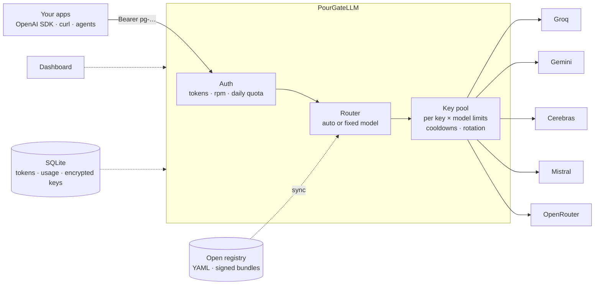

<div align="center">


# PourGateLLM

**One OpenAI-compatible endpoint for every free LLM tier.**
Pour all your providers' free quotas through a single, self-hosted gate: with failover, per-client tokens, an open model registry and a dashboard.

[](https://github.com/xX-VyrnCore-Xx/PourGateLLM/actions/workflows/ci.yml)


[Quick start](#-quick-start) ·
[Features](#-features) ·
[How it works](#-how-it-works) ·
[Configuration](#-configuration) ·
[Roadmap](#-roadmap) ·
[Design doc](DESIGN.md)

<br />

<picture>
  <source media="(prefers-color-scheme: dark)" srcset="docs/screenshots/providers-dark.png">
  
</picture>

</div>

<br />

## Why PourGateLLM?

Free LLM tiers are generous but scattered: different keys, different limits, different failure modes.
PourGateLLM sits in front of them and gives your apps **one stable `/v1` endpoint** that keeps working when a single key or provider runs dry.

- **Drop-in.** Any OpenAI SDK or tool works by changing the base URL and key.
- **Respects limits.** Per-key, per-model `rpm`/`rpd`/`tpm`/`tpd` accounting and cooldowns, kept across restarts.
- **Open catalog.** Providers and models live in a plain-YAML [registry](registry) anyone can improve with a PR. No paywalled feed.
- **Safe by default.** Keys encrypted at rest, hashed client tokens, a registry that can never redirect your keys to unknown hosts.

> [!NOTE]
> PourGateLLM is for **personal and small-team use** of free tiers, within each provider's terms. Rotating many accounts to dodge limits can violate those terms, so don't.

## ✨ Features

| | |
|---|---|
| 🔌 **OpenAI-compatible API** | `GET /v1/models` and `POST /v1/chat/completions` with streaming passthrough. Use `"model": "auto"` or a specific model id. |
| 🧠 **Complexity routing** | `"model": "auto"` classifies each prompt (size, code, reasoning, tools…) and tries small, fast models for easy questions and the strongest ones for hard tasks, with automatic fallback to the other tiers. |
| 🔁 **Smart failover** | On `429` / `5xx` / network errors it rotates to the next key, then the next model, honoring `Retry-After`. |
| 📊 **Real quota accounting** | `rpm`, `rpd`, `tpm`, `tpd` enforced per key *and* model. Daily counters and cooldowns persist in SQLite. |
| 🔑 **Per-client tokens** | Create tokens with their own rate limit, daily quota and expiry. Stored as SHA-256 hashes, revocable any time. |
| 🖥️ **Dashboard** | React + Tailwind UI in light and dark mode (English, Italian): manage tokens and provider keys, test keys, watch usage. |
| 🗂️ **Open model registry** | YAML catalog with local overrides and optional signed, auto-syncing bundles. |
| 🔐 **Encrypted provider keys** | AES-256-GCM in SQLite, bound to the provider; the UI only ever shows the last 4 characters. |
| 🐳 **Self-hosting ready** | Docker image and Compose file, one SQLite file, zero external services. |

<details>
<summary><b>Supported providers (MVP)</b></summary>

<br />

| Provider | Registry file | Key variable |
|---|---|---|
| Groq | [`registry/groq.yaml`](registry/groq.yaml) | `GROQ_API_KEYS` |
| Google Gemini | [`registry/gemini.yaml`](registry/gemini.yaml) | `GEMINI_API_KEYS` |
| Cerebras | [`registry/cerebras.yaml`](registry/cerebras.yaml) | `CEREBRAS_API_KEYS` |
| Mistral | [`registry/mistral.yaml`](registry/mistral.yaml) | `MISTRAL_API_KEYS` |
| OpenRouter (`:free` models) | [`registry/openrouter.yaml`](registry/openrouter.yaml) | `OPENROUTER_API_KEYS` |

> [!WARNING]
> Model ids and limits in the registry are **best-effort and not yet verified** against live providers (entries without `verified_at` are unverified). Check them against each provider's docs, and send a PR when you find a mistake.

</details>

## 🚀 Quick start

### With Docker

```bash
git clone https://github.com/xX-VyrnCore-Xx/PourGateLLM.git && cd PourGateLLM
cp .env.example .env          # set POURGATE_TOKENS, POURGATE_ADMIN_PASSWORD and your provider keys
docker compose up -d --build
```

### From source

Requires **Node ≥ 22.13** and **pnpm**.

```bash
pnpm install && pnpm build
export POURGATE_TOKENS=pg-$(openssl rand -hex 16)
export POURGATE_ADMIN_PASSWORD=$(openssl rand -hex 16)
export GROQ_API_KEYS=gsk_...
pnpm start
```

Open **http://localhost:3000** for the dashboard, or call the API:

```bash
curl http://localhost:3000/v1/chat/completions \
  -H "Authorization: Bearer $POURGATE_TOKENS" -H "Content-Type: application/json" \
  -d '{"model":"auto","messages":[{"role":"user","content":"Hello!"}]}'
```

<details>
<summary><b>Use it from the OpenAI SDKs</b></summary>

<br />

```python
from openai import OpenAI

client = OpenAI(base_url="http://localhost:3000/v1", api_key="pg-your-token")
reply = client.chat.completions.create(
    model="auto",
    messages=[{"role": "user", "content": "Hello!"}],
)
print(reply.choices[0].message.content)
```

```ts
import OpenAI from "openai";

const client = new OpenAI({ baseURL: "http://localhost:3000/v1", apiKey: "pg-your-token" });
const reply = await client.chat.completions.create({
  model: "auto",
  messages: [{ role: "user", content: "Hello!" }],
});
console.log(reply.choices[0]?.message.content);
```

</details>

Every response carries `x-pourgate-provider` and `x-pourgate-model` headers so you can see who answered.

See [Complexity routing](#-complexity-routing) for how `auto` picks a model.

## 🧭 How it works



1. A request arrives with a **client token** that is checked, rate-limited and counted against its quota.
2. The **router** lists the models able to serve it, from the registry, and tries them in order.
3. The **key pool** picks the next key that still has budget for that model, so limits are respected per key *and* model.
4. If the provider answers `429`/`5xx`, that key cools down (persisted) and the next key or model takes over. Successful responses, including streams, are passed through untouched.

## 🧠 Complexity routing

`"model": "auto"` looks at each request and decides how much model it deserves, **without spending any provider quota** (it is a small deterministic classifier, not another LLM call).

| Signal | Examples |
|---|---|
| Size | prompt length, very long last message, long conversations |
| Content | code, math, reasoning/engineering wording in English and Italian (*analyze*, *debug*, *prove*, *analizza*, *ottimizza*…) |
| Request shape | tool use, strict JSON schema, large `max_tokens`, `reasoning_effort` |
| Simplicity | short greetings, definitions, translations lower the score |

The score maps to `easy → small`, `medium → medium`, `hard → large`, using the `tier` hint of each model in the [registry](registry). The tier is a **preference, not a filter**: if the preferred tier has no budget left, the next ones take over. Within a tier the model that served the fewest requests today goes first, which spreads load across providers.

Models that cannot serve the request are skipped (missing `tools` / `json_mode` / `vision` capability, or a context window that is too small); if none can, you get a clear `400 no_capable_model`.

| Model id | Behavior |
|---|---|
| `auto` | Classify the prompt, then pick the tier |
| `auto:small` · `auto:medium` · `auto:large` | Force the tier to try first |
| any registry model id | Use exactly that model (no classification) |

Responses include `x-pourgate-complexity` (for `auto`) and `x-pourgate-tier` so you can see the decision. Tiers in the registry are hints (`tier: small|medium|large`); adjust them with local overrides (`POURGATE_OVERRIDES_DIR`) if you disagree.

## 🖼️ Dashboard

<picture>
  <source media="(prefers-color-scheme: dark)" srcset="docs/screenshots/tokens-dark.png">
  
</picture>

Set `POURGATE_ADMIN_PASSWORD` to enable it. Sessions use an `HttpOnly`, `SameSite=Strict` cookie, login attempts are rate-limited, and cross-origin writes are rejected. Serve it over HTTPS and set `POURGATE_COOKIE_SECURE=true`.

## ⚙️ Configuration

All configuration is through environment variables (see [`.env.example`](.env.example)).

| Variable | Default | Description |
|---|---|---|
| `POURGATE_TOKENS` | | Static, unlimited bootstrap client tokens (comma-separated). Prefer per-client tokens below. |
| `POURGATE_ADMIN_PASSWORD` | | Enables the dashboard and admin API. Use a long random value. |
| `POURGATE_COOKIE_SECURE` | `false` | Mark the session cookie `Secure` (use behind HTTPS). |
| `<PROVIDER>_API_KEYS` | | Provider keys, comma-separated (`GROQ_API_KEYS`, `GEMINI_API_KEYS`, ...). Merged with keys added in the dashboard. |
| `POURGATE_MASTER_KEY` | auto | 32-byte key (hex or base64) encrypting dashboard-stored keys. Generate with `openssl rand -hex 32`. If unset, `data/master.key` is created on first start. |
| `POURGATE_DB` | `data/pourgate.db` | SQLite database path. |
| `PORT` | `3000` | HTTP port. |
| `POURGATE_REGISTRY_DIR` | `registry` | Directory with the shipped provider YAML files. |
| `POURGATE_OVERRIDES_DIR` | `overrides` | Local YAML files that override or extend the registry. |
| `POURGATE_REGISTRY_URL` | | Bundle URL to sync the registry from. |
| `POURGATE_REGISTRY_PUBKEY` | | Ed25519 public key (PEM or file path). When set, bundles **must** be signed. |
| `POURGATE_REGISTRY_SYNC_HOURS` | `12` | Sync interval. |
| `POURGATE_STATIC_DIR` | `public`, else `packages/client/dist` | Built dashboard directory. |

### Client tokens

Create them in the dashboard, or from the CLI:

```bash
pnpm cli tokens create --name laptop --rpm 30 --daily 500 --expires-days 90
pnpm cli tokens list
pnpm cli tokens revoke 1
# in Docker:
docker compose exec pourgate node dist/cli.js tokens create --name laptop --rpm 30
```

### Limits and cooldowns

Registry limits apply per **key and model**. `rpm`/`tpm` use a sliding 60 s window (in memory), while `rpd`/`tpd` are UTC-day counters and key cooldowns are persisted in SQLite, so they survive restarts. Cooldowns follow the provider's `Retry-After` (capped at 24 h). Keys are tracked by an HMAC fingerprint, never by their raw value.

> [!NOTE]
> Token limits (`tpm`/`tpd`) use the `usage.total_tokens` reported on **non-streaming** responses. Streamed responses count as requests only.

## 🗂️ The open registry

Providers and models are described in small YAML files:

```yaml
provider: groq
base_url: https://api.groq.com/openai/v1
api_key_env: GROQ_API_KEYS
models:
  - id: llama-3.3-70b-versatile
    capabilities: [chat, tools, json_mode]
    context: 131072
    limits: { rpm: 30, rpd: 1000, tpm: 12000, tpd: 100000 }
    verified_at: 2026-10-01   # only when you checked it against the provider's docs
```

**Contributing a fix?** Edit the file under [`registry/`](registry) and open a PR. CI validates the schema.

**Following a published bundle?** Build one and point gateways at it:

```bash
pnpm cli registry keygen --out-dir keys
pnpm cli registry bundle --out dist/registry.json --sign keys/registry-private.pem
# gateway: POURGATE_REGISTRY_URL=https://example.com/registry.json  POURGATE_REGISTRY_PUBKEY=./registry-public.pem
```

<details>
<summary><b>Trust model: why a registry cannot steal your keys</b></summary>

<br />

Registry entries decide **where your API keys are sent**, so remote data is treated as untrusted:

- **Unsigned bundles** may only update models, limits and quirks of providers already shipped locally. Endpoints, key variables and new providers are ignored.
- **Signed bundles** (Ed25519, public key you configure) may add providers, but endpoints must be public `https` URLs and the key variable must end in `_API_KEYS`, so a bundle can never target `POURGATE_TOKENS` or private hosts.
- Older versions are rejected, bundles are capped at 2 MB, and the last good bundle is cached and re-verified on restart.
- Your **local overrides always win**.

</details>

## 🔒 Security at a glance

- Provider keys encrypted at rest with **AES-256-GCM**, never logged or returned by the API.
- Client tokens stored only as **SHA-256 hashes**; the plaintext is shown once, at creation.
- Constant-time token comparison, login rate limiting, `SameSite=Strict` sessions, cross-origin write protection.
- Registry sync hardened against endpoint hijacking, rollback and oversized payloads.

Found a vulnerability? Please open a private security advisory on GitHub rather than a public issue.

## 🛣️ Roadmap

- [x] OpenAI chat completions + models, streaming, failover
- [x] Per-key, per-model limits with persistence
- [x] Per-client tokens and quotas
- [x] Dashboard (tokens, provider keys, registry, usage)
- [x] Encrypted provider keys
- [x] Open registry with signed sync and overrides
- [x] Docker image and Compose
- [ ] Periodic evals to rank models on real quality, latency and reliability
- [x] Routing by prompt complexity (heuristic classifier)
- [ ] Semantic and prompt caching
- [ ] OpenTelemetry metrics and log export
- [ ] PII redaction and per-provider privacy policies
- [ ] Plugin system for providers, strategies and middleware
- [ ] Anthropic Messages, embeddings, images and audio endpoints
- [ ] Desktop app

See [DESIGN.md](DESIGN.md) for the full vision, architecture and open questions.

## 🧑‍💻 Development

```bash
pnpm install
pnpm typecheck && pnpm test     # server tests run on Vitest
pnpm dev                        # API on :3000 (run from the repo root)
pnpm --filter @pourgate/client dev   # dashboard on :5173 (proxies the API)
```

```
packages/
  shared/    registry schema (Zod)
  server/    Hono gateway, router, key pool, SQLite, admin API, CLI
  client/    React + Vite + Tailwind dashboard
registry/    provider & model catalog (YAML)
docs/        logo and screenshots
```

Contributions are welcome, especially **registry fixes and new providers**. Open an issue or a PR.

## 📄 License

[MIT](LICENSE)
